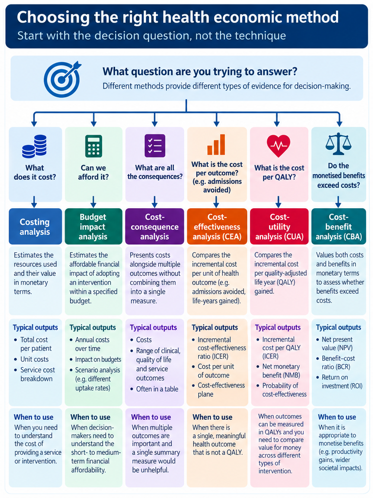

# Module 16: Methods for Applying Health Economics to Healthcare Decisions 

Healthcare Decision Intelligence

## 1. From understanding value to applying methods

Module 15 established why health economics matters: healthcare decisions must consider benefits in relation to limited resources. This module moves from principles to practical analytical methods. It explains how to define a comparison, estimate resource use and outcomes, choose an appropriate method, calculate results and test whether conclusions are robust. It is not a substitute for specialist health economics advice on high-stakes decisions.

### Learning objectives

-   Specify an economic analysis using a population, intervention, comparator, outcomes, perspective and time horizon.

-   Construct transparent resource-use and cost estimates, distinguishing economic costs from budget expenditure.

-   Choose among partial evaluations, full economic evaluations and supporting financial analyses.

-   Calculate and interpret incremental costs, incremental effects, ICERs and net monetary benefit.

-   Build a simple budget impact analysis and examine uncertainty and variation across groups.

-   Present limitations and evidence requirements clearly to commissioners.

## 2. Specify the decision and analytical scope

Begin with the decision to be supported, not with a preferred technique. Write a one-sentence decision question, then specify the elements below before collecting data.

  ----------------------------------------------------------------------------------------------------------------------------------------------------
  Element                 What the analyst specifies                                    Example: community frailty service
  ----------------------- ------------------------------------------------------------- --------------------------------------------------------------
  Population              Eligibility, baseline risk, expected number and subgroups     1,000 eligible older adults with frailty

  Intervention            Service model, intensity, start-up and running requirements   Enhanced multidisciplinary support

  Comparator              What would realistically happen otherwise                     Current community and acute pathway

  Outcomes                Health, patient experience and healthcare resource use        Admissions, quality of life, staff time

  Perspective             Which costs and outcomes are included                         NHS and personal social services; additional ICB budget view

  Time horizon            Duration, price year and any discounting                      12 months for illustrative model; longer if benefits persist
  ----------------------------------------------------------------------------------------------------------------------------------------------------

A comparator is essential for attributing incremental costs and outcomes. Observed changes in a single service are not automatically effects caused by that service; the evaluation design must support the effect estimate. Refer to earlier evaluation modules for causal methods.

### Methodological distinction: partial and full evaluations

A partial economic evaluation describes costs, outcomes, or both without comparing alternatives on both dimensions. Examples include costing a pathway and estimating the burden of COPD. These are legitimate analyses, but a high disease cost does not demonstrate that a particular intervention is cost-effective.

A full economic evaluation compares at least two relevant alternatives on both costs and consequences. Cost-consequence, cost-effectiveness, cost-utility and cost-benefit analyses are different ways of organising those comparisons. Budget impact analysis and financial ROI answer additional financial questions; neither substitutes for a health-outcome comparison.

An evaluation can be rigorous without being elaborate. The minimum defensible design is determined by the decision, the quality of comparative evidence and the consequences that can be credibly measured.

## 3. Build the cost and resource-use dataset

Use the sequence identify → measure → value. For each resource, record the unit, quantity, unit cost, source, price year and whether it is additional, displaced or already available. Separate set-up from recurrent resource use. Gross costing uses average episode costs; micro-costing itemises staff minutes, tests, supplies and other inputs. The right level of detail depends on the decision.

  -----------------------------------------------------------------------------------------
  Resource                            Quantity          Unit cost         Total
  ----------------------------------- ----------------- ----------------- -----------------
  Nurse time                          1,200 hours       £45/hour          £54,000

  Care coordinator                    800 hours         £35/hour          £28,000

  Training and implementation         One programme     £18,000           £18,000

  Total illustrative programme cost                                       £100,000
  -----------------------------------------------------------------------------------------

These values are invented for teaching, not NHS reference costs. Use current authoritative unit-cost sources and document local adjustments. Check whether the source represents actual resource cost, reimbursement price or cash expenditure: they are not interchangeable. For a multi-year analysis, apply the appropriate price-year adjustments and discounting conventions for the appraisal being undertaken.

### Costing checks

-   Does the caseload match the staffing model and utilisation assumptions?

-   Are overheads, implementation, digital integration and ongoing maintenance included?

-   Could changes in care shift costs to another provider or to patients and carers?

-   Are resource-use outcomes counted consistently without duplicating the same event?

### Practical costing: bottom-up and top-down approaches

Micro-costing measures individual resource inputs, such as minutes of nursing time, equipment, software licences and tests. It is particularly useful when a new service has no established unit cost. Gross or top-down costing applies average episode or service costs to activity counts. This is efficient for established pathways but may conceal variation in case mix and resource intensity.

For example, 1,200 nurse hours at an illustrative £45 per hour cost £54,000. This is a resource-cost estimate, not automatically a new cash requirement: the financial implication depends on whether extra staff or paid sessions are needed. State the cost source, price year, caseload and assumptions about utilisation.

Cost of illness studies may be prevalence-based (the cost associated with everyone living with a condition in a defined period) or incidence-based (the costs over time for a cohort of new cases). Such studies describe burden and inform planning, but do not establish the value of an intervention.

Healthcare resource utilisation (HCRU) may be presented as an outcome (e.g. admissions avoided) and used to calculate costs. Keep the accounting transparent: do not add a monetised avoided admission to the same avoided admission already represented in total cost differences.

## 4. Choose the method that answers the question

A full economic evaluation compares at least two options on both costs and outcomes. Partial and supporting analyses are valuable, but cannot independently answer every question about comparative value.

  -----------------------------------------------------------------------------------------------------------------------------------------------
  Method                                Typical output                                Best use
  ------------------------------------- --------------------------------------------- -----------------------------------------------------------
  Costing / cost of illness             Cost per service or disease burden            Size the resource requirement or problem

  Cost-consequence analysis (CCA)       Table of costs and multiple outcomes          Local pathways with several important outcomes

  Cost-effectiveness analysis (CEA)     Incremental cost per natural outcome          Comparable interventions with a common outcome

  Cost-utility analysis (CUA)           Incremental cost per QALY                     Health gains compared on a common scale

  Cost-benefit analysis (CBA)           Monetary net benefit / benefit-cost ratio     Cross-sector public policy choices

  Cost-minimisation / cost comparison   Difference in costs                           Only where comparable outcomes are adequately established

  Budget impact analysis (BIA)          Annual expenditure difference                 Affordability for a defined budget holder

  Return on investment (ROI)            Net financial return relative to investment   Financial payback, with tightly specified cash flows
  -----------------------------------------------------------------------------------------------------------------------------------------------

CCA, CEA, CUA and CBA are full evaluations when they compare relevant alternatives. Budget impact and ROI are supporting analyses rather than replacements for health-outcome assessment. In practice a local programme may require a CCA alongside a BIA, with a more detailed CUA if reliable utility evidence exists.

Flowchart linking six decision questions to costing, budget impact, cost-consequence, cost-effectiveness, cost-utility and cost-benefit analysis.

The infographic is a method-selection aid, not a substitute for specifying the comparator and evidence. The accompanying table also covers cost-minimisation and ROI.

### Choosing the right output

Cost-consequence analysis (CCA) is often a practical starting point for integrated pathways: it presents costs, patient outcomes, activity, workforce effects and inequalities in separate rows. The decision-maker must still weigh these outcomes explicitly; the method does not make trade-offs disappear.

Cost-effectiveness analysis (CEA) expresses incremental cost per natural unit, such as an admission avoided or an additional person receiving effective treatment. Different natural outcomes are not directly interchangeable. Cost-utility analysis (CUA) uses QALYs, which combine survival time and health-related quality of life, often informed by EQ-5D responses and a stated valuation set.

Cost-benefit analysis (CBA) converts included consequences into monetary values, enabling comparison across sectors. Methods such as willingness-to-pay surveys and productivity valuation introduce ethical, equity and methodological assumptions. Cost-minimisation should be used only when sufficiently strong evidence establishes equivalent relevant outcomes; a non-significant difference is not proof of equivalence.

## 5. Worked case study: evaluating a community frailty service

::: {.callout-note}
### Illustrative teaching example — not an NHS effectiveness estimate

All populations, costs, effects, utility gains and scenarios below are fictional. The case demonstrates **how an analyst would undertake and communicate an economic evaluation**, not whether community frailty services actually achieve these effects. In practice, a robust comparison or evaluation design is needed to estimate causal impact.
:::

An ICB is considering an enhanced multidisciplinary community frailty service for older people with frailty and complex needs. The proposed service combines proactive assessment, medication review, care coordination and rapid community response. The analyst is asked whether to commission the service and what evidence is needed before scaling it.

An Illustrative economic evaluation: plus £100,000 incremental cost, 40 admissions avoided, six QALYs gained, £2,500 per admission avoided, £16,667 per QALY, plus £20,000 net monetary benefit at an illustrative £20,000 per QALY, and a separate £270,000 three-year net budget impact.

The figure summarises fictional teaching calculations. The one-year economic evaluation and three-year budget scenario have different scopes and must not be added together.*

### Step 1 — Specify the decision

| Element | Specification for this example |
|---|---|
| Decision | Commission enhanced community frailty support or continue the current pathway? |
| Population | 1,000 eligible people with frailty, followed for one year |
| Intervention | Enhanced multidisciplinary community service |
| Comparator | Existing community and acute care pathway |
| Perspective | NHS and personal social services resource costs for economic evaluation |
| Time horizon | One year, sufficient only for this teaching calculation |
| Outcomes | Emergency admissions, QALYs and other consequences |
| Additional analysis | Annual budget impact from the relevant ICB budget-holder perspective |

In a real study, document the service specification, eligibility, baseline risk, outcome definitions, evidence sources, unit-cost price year and whether a longer horizon is needed. The intervention and comparator must be evaluated over a consistent period.

### Step 2 — Assemble resource use and outcome evidence

Assume a credible comparative evaluation or appropriately justified model produced the following **one-year totals for the same-sized cohorts**:

| Measure | Current pathway | Enhanced service | Increment |
|---|---:|---:|---:|
| Total economic resource cost | £2,000,000 | £2,100,000 | +£100,000 |
| Emergency admissions | 300 | 260 | −40 |
| QALYs across 1,000 people | 600 | 606 | +6 |

The £2.1 million already represents **all included resource costs under the stated perspective**, including the intervention and changes in service use. Do not subtract an additional value for the 40 avoided admissions from this figure: doing so could double-count effects already reflected in total costs. Likewise, a reduction in admissions is not itself evidence of improved health; inspect patient outcomes, safety and access.

### Step 3 — Calculate cost-effectiveness in natural units

Incremental cost:

\[
\Delta C = £2{,}100{,}000 - £2{,}000{,}000 = £100{,}000
\]

Incremental admissions avoided:

\[
\Delta E_{\mathrm{admissions}} = 300 - 260 = 40
\]

Cost per additional admission avoided:

\[
ICER_{\mathrm{admissions}} = \frac{£100{,}000}{40}
= £2{,}500\ \text{per admission avoided}
\]

**Interpretation:** the enhanced service costs £2,500 more in total economic resources per additional admission avoided, under these assumptions. That is not automatically good or poor value: admissions avoided are not a universal measure of health benefit and there is no universal acceptable price per admission avoided.

### Step 4 — Calculate cost-utility

A QALY combines length of life with health-related quality of life. The example assumes an incremental **six QALYs across the cohort**; it does not establish how those gains arose. In a real evaluation, explain the utility instrument and valuation set, survival assumptions, missing-data handling and any extrapolation.

\[
\Delta Q = 606-600 = 6\ \text{QALYs}
\]

\[
ICER_{\mathrm{QALY}} = \frac{£100{,}000}{6}
\approx £16{,}667\ \text{per additional QALY}
\]

The point estimate lies in the **north-east quadrant** of the cost-effectiveness plane: the service is more effective but also more costly. It therefore requires a judgement about the value of the additional benefit, rather than being automatically preferred.

### Step 5 — Use net monetary benefit to explore the decision

Incremental net monetary benefit (INMB) expresses incremental QALYs and costs in a common monetary metric at an **explicitly assumed** value per QALY, \(\lambda\):

\[
INMB = (\lambda \times \Delta Q)-\Delta C
\]

| Illustrative value per QALY | Calculation | INMB |
|---|---|---:|
| £15,000 | (6 × £15,000) − £100,000 | −£10,000 |
| £20,000 | (6 × £20,000) − £100,000 | +£20,000 |
| £25,000 | (6 × £25,000) − £100,000 | +£50,000 |

These are **illustrative values, not a statement of the applicable current NICE threshold or an ICB commissioning rule**. At £20,000, the model's positive INMB is only £20,000 for the entire cohort, making it important to test uncertain inputs.

At an assumed £20,000 per QALY, the break-even QALY gain is:

\[
\Delta Q_{\mathrm{break-even}} = \frac{£100{,}000}{£20{,}000}=5
\]

If the true gain were below five QALYs, the modelled INMB would be negative at that assumed value.

### Step 6 — Present a cost-consequence table

A cost-consequence analysis is useful for an ICB because it preserves outcomes that cannot responsibly be combined into one number.

| Consequence | Difference under illustrative assumptions | Evidence required before decision |
|---|---|---|
| Economic resource costs | +£100,000 | Resource-use records and defensible unit costs |
| Emergency admissions | 40 fewer | Comparative activity analysis with appropriate adjustment |
| Health-related quality and survival | +6 QALYs | Utility and survival evidence |
| Patient and carer experience | Not estimated | Qualitative evidence and patient-reported measures |
| Workforce demand | Not estimated | Staffing and implementation plan |
| Access and inequalities | Not estimated | Reach and outcomes by relevant population groups |
| Patient safety or unintended harm | Not estimated | Clinical governance and safety monitoring |

**Do not infer** that omitted consequences are zero. In particular, a programme that reaches only people already well connected to services could worsen inequalities despite a favourable average economic result.

### Step 7 — Build the budget impact separately

The economic analysis above covers **one year for a fixed cohort of 1,000 people**. An ICB also needs a multi-year spending plan as the service is rolled out. The following figures illustrate a **separate, fictional three-year implementation scenario for the same type of service**; they are not directly derivable from the one-year cohort totals.

| Financial year | People enrolled | Incremental programme expenditure | Verified cash budget offsets | Net additional budget |
|---|---:|---:|---:|---:|
| Year 1 | 400 | £80,000 | £10,000 | £70,000 |
| Year 2 | 700 | £120,000 | £25,000 | £95,000 |
| Year 3 | 1,000 | £150,000 | £45,000 | £105,000 |
| **Three-year total** | — | **£350,000** | **£80,000** | **£270,000** |

The net budget impact is **£350,000 − £80,000 = £270,000** over three years. The figures are annual flows, not cumulative enrolment costs. The offsets are **assumed to be verifiable for teaching purposes**; in a real business case they must be traced to actual reducible budget lines. If no expenditure can genuinely be reduced, the offsets must be removed. A released bed or an avoided admission does not automatically generate cash.

The one-year economic cost increment (£100,000) and the three-year incremental programme expenditure (£350,000) are **not additive**: they cover different horizons, populations and accounting scopes.

### Step 8 — Test the assumptions that could change the result

For a simple **one-way sensitivity illustration**, hold incremental economic cost at £100,000 and vary only the assumed QALY gain, using an illustrative £20,000 per QALY:

| Incremental QALYs | ICER per QALY | INMB at £20,000/QALY | Interpretation |
|---:|---:|---:|---|
| 3 | £33,333 | −£40,000 | Negative INMB |
| 5 | £20,000 | £0 | Break-even |
| 6 (base case) | £16,667 | +£20,000 | Positive INMB |
| 8 | £12,500 | +£60,000 | More favourable |

This table is **not a confidence interval or a probability of cost-effectiveness**. It only shows the sensitivity to one assumption. A fuller analysis should vary staffing costs, uptake, baseline admission risk, intervention effectiveness, implementation delay, the comparator and the time horizon; use probabilistic sensitivity analysis where defensible parameter distributions are available.

### Step 9 — Translate findings into an analytical recommendation

::: {.callout-tip}
### Example of a proportionate decision summary

**Question:** Should the ICB commission enhanced community frailty support?

**Modelled finding:** For a fictional 1,000-person cohort, the enhanced service has £100,000 higher one-year economic resource costs, 40 fewer emergency admissions and six additional QALYs. The ICER is approximately £16,667 per QALY. At an illustrative £20,000 per QALY, INMB is +£20,000.

**Affordability:** A separate fictional phased rollout requires £270,000 additional net budget over three years, assuming £80,000 of independently verifiable cash offsets.

**Limitations:** The estimates are assumed rather than observed. There is no established causal effect, subgroup evidence, safety assessment or real-world implementation cost.

**Recommended next analytical action:** Confirm the comparator, obtain local baseline and resource-use data, agree a prospective evaluation with suitable comparison, assess equity and feasibility, and update both the economic and budget models before any major scale-up decision.
:::

This sequence shows how an analyst can move from **decision specification → evidence and costing → incremental comparison → multiple economic methods → budget impact → uncertainty → a defensible recommendation** without confusing estimated value with actual cash savings.

## 6. Test uncertainty before drawing conclusions

A base-case estimate is not a certainty. Test uncertainty in inputs and assumptions and explain how this changes the decision. Distinguish sampling uncertainty, real variation between subgroups, structural choices and uncertainty about transferability to the local NHS setting.

### One-way and scenario sensitivity analysis

Change one influential assumption at a time, such as uptake, staff costs or intervention effectiveness. A tornado diagram can show which assumptions move the result most. Scenario analysis changes coherent sets of assumptions, such as a slower rollout or a different comparator. A threshold analysis asks: at what effect size or cost does the preferred option cease to be attractive?

### Probabilistic sensitivity analysis

Assign justified probability distributions to uncertain model parameters and repeatedly sample them. Plot simulated incremental costs and effects on a cost-effectiveness plane. A cost-effectiveness acceptability curve shows the proportion of simulations meeting each specified threshold. This proportion is conditional on the model and distributions; it does not account for omitted structural uncertainty.

### Subgroups and equity

Where evidence permits, explore whether effects and costs differ by age, frailty severity, deprivation, ethnicity, geography or baseline risk. Pre-specify meaningful subgroup analyses, avoid overinterpreting small samples and distinguish genuine heterogeneity from noise. Economic results should not obscure unequal access or harms.

### Quantifying uncertainty: from scenarios to probabilities

One-way sensitivity analysis varies one parameter while holding others fixed; a tornado chart can rank influential inputs. Scenario analysis changes several linked assumptions, for example a slower implementation and lower uptake. Threshold analysis identifies the cost or effect at which a conclusion changes.

Probabilistic sensitivity analysis (PSA) assigns defensible distributions to uncertain parameters and runs repeated simulations. Appropriate distribution choices depend on the parameter: probabilities are bounded, costs are often skewed and correlated effects should not be sampled independently without justification. Results may be displayed as a cloud of points on the cost-effectiveness plane and as a cost-effectiveness acceptability curve.

An acceptability curve reports the proportion of model simulations in which an option is cost-effective at a specified threshold, conditional on the model, evidence and distributions. It is not a guarantee of real-world success. Where data are weak, structural assumptions and alternative model forms may matter more than the apparent precision of the simulations.

For interventions with longer-term consequences, decision trees may suit short, discrete pathways; state-transition (Markov) models may suit recurring health states; and discrete-event simulation may suit individual patient pathways, competing events and resource constraints. Select model complexity according to the decision and available evidence.

## 7. A practical workflow for analysts

1.  Frame the decision and comparator; agree the perspective and time horizon.

2.  Build the population denominator and resource-use dataset.

3.  Identify credible comparative effect estimates and document evidence quality.

4.  Choose the method the evidence can support; do not overclaim from partial analyses.

5.  Calculate incremental costs and effects, with a reproducible audit trail.

6.  Prepare annual budget impact separately from economic value.

7.  Test uncertainty, implementation scenarios and important population subgroups.

8.  Produce a decision-ready summary: results, assumptions, limitations and next evidence needs.

### Subgroups, equity and transferability

Check whether baseline risk, treatment effect, access and delivery cost differ meaningfully across relevant groups or places. Age, frailty, multimorbidity and deprivation may affect both baseline outcomes and expected programme impact. Report subgroup sample sizes and uncertainty, and avoid treating exploratory differences as established effects.

An intervention may have a favourable overall average while offering little benefit to people facing barriers to access. Distributional cost-effectiveness analysis can formally examine health inequality impacts when appropriate data and specialist expertise are available. For many local analyses, a transparent subgroup and access assessment is the more proportionate first step.

Before transferring published economic results to an ICB, test whether the comparator, local service configuration, workforce costs, population risk, uptake and capacity constraints are sufficiently similar.

## 8. Communicating the analysis to decision-makers

An effective analytical output should show: the decision question; the options compared; population and time horizon; the base-case cost and outcome differences; the method used; the principal uncertainties; annual budget implications; distributional effects; and what evidence could change the conclusion. Present one-page results supported by a transparent technical appendix. Never describe a modelled association as a demonstrated causal impact.

### Questions to check before publication

-   Is the comparator realistic and does the effect estimate come from an appropriate evaluation design?

-   Are resource costs, budget changes and health outcomes clearly distinguished?

-   Can every numerical assumption be traced to a source, price year or explicit judgement?

-   Does the model use an appropriate time horizon and discounting convention?

-   Are uncertainty, omitted effects and local transferability clearly disclosed?

-   Would the conclusion change under plausible assumptions or for important subgroups?

### Minimum reporting standard

Provide a one-page decision summary with the decision and comparator; population and setting; perspective and horizon; cost source and price year; incremental costs and outcomes; uncertainty; budget profile; subgroup impacts; limitations; and evidence needed before implementation or scaling. Retain a reproducible model, data dictionary and assumption log.

Use CHEERS 2022 as a reporting checklist for full health economic evaluations, alongside the relevant current NICE methods guidance where applicable. Do not present a local exploratory costing exercise as though it meets the evidential standards of a formal technology appraisal.

## 9. Practical exercise

An ICB is considering extending a community service to a second locality. The initial proposal estimates £250,000 annual spending, 50 fewer emergency admissions and improved patient experience, but has no comparison group. Draft a two-page analysis plan: specify the comparator, the minimum dataset, the preferred initial economic method, a three-year BIA, the evaluation design needed to estimate admissions avoided, and two scenarios for uncertainty. Explain which claims cannot yet be made.

## 10. Key messages

-   The method follows the decision question and the available evidence.

-   Incremental analysis compares a new option with a realistic alternative.

-   Costing, full economic evaluation and budget impact are complementary but distinct.

-   CEA, CUA and CCA express outcomes differently; no single method fits every local decision.

-   Uncertainty, model assumptions and differences between population groups are part of the result.

-   A transparent, limited analysis is more useful than an elaborate model that answers the wrong question.

## Further reading and methodological references

-   Drummond MF et al. Methods for the Economic Evaluation of Health Care Programmes. 4th ed. Oxford University Press, 2015.

-   NICE. Health technology evaluations: the manual (PMG36); consult current version and relevant appraisal reference case.

-   Husereau D et al. CHEERS 2022 statement. Value in Health, 2022.

-   Sullivan SD et al. Budget impact analysis: principles of good practice. Value in Health, 2014.

-   Briggs AH et al. Model parameter estimation and uncertainty analysis: ISPOR-SMDM good research practices, 2012.

-   HM Treasury. The Green Book: current edition and supplementary guidance.

