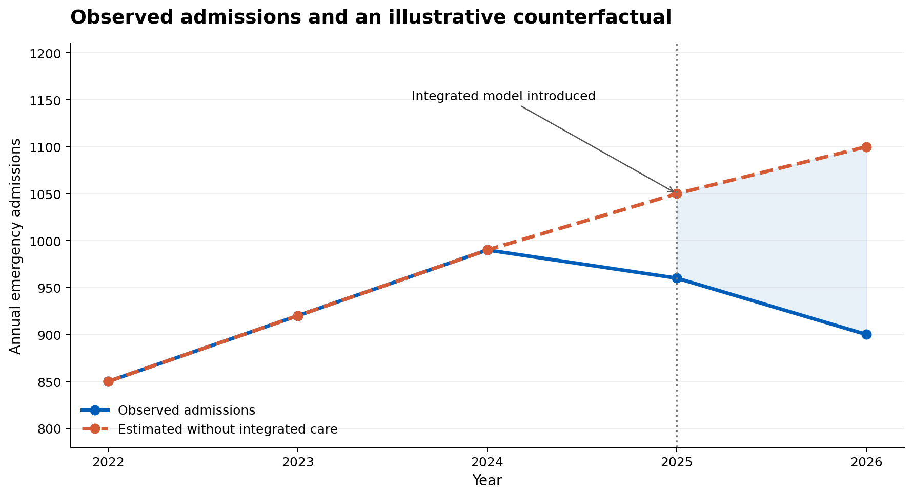

# Module 17: Understanding What Made the Difference

## Evaluating Multiple Interventions in Complex Healthcare Systems

<button class="print-button" onclick="window.print()">🖨️ Print this module</button>

## 1. Why This Module Matters

Healthcare systems rarely introduce one intervention at a time. An Integrated Care Board (ICB) may invest simultaneously in proactive frailty care, enhanced care home support, Urgent Community Response (UCR), virtual wards and enhanced end-of-life care. These programmes may reach the **same people**, operate at different points along the **same pathway**, and claim improvements in the **same outcomes**.

Suppose emergency admissions among people living with severe frailty fall by 8%. Several programme reports describe admissions avoided. Which intervention made the difference? Did the interventions work together? Were some patients counted more than once? And did the combined investment represent good value?

This module moves beyond evaluating schemes individually towards understanding the **contribution and value of a portfolio of interventions**.

::: {.callout-important collapse="false"}
## The Central Question

**What combination of interventions appears to be creating value, for whom, through what mechanisms, and how confident are we?**

The purpose is not to award each programme a share of the improvement when the evidence cannot support that conclusion.

**The first task is to establish whether the combined model of care improved outcomes for the eligible population compared with what would otherwise have happened.** Understanding individual pathways, interactions, equity and economic value then helps explain and use that estimate.
:::

### Building on Earlier Modules

- **Theory of Change and Logic Models** make expected mechanisms, outcomes and assumptions explicit.
- **The evaluation modules** introduce counterfactual thinking, comparison groups, Interrupted Time Series (ITS), Difference-in-Differences (DiD) and proportionate evaluation design.
- **Module 15** distinguishes economic value, affordability, opportunity cost and different types of financial and non-financial benefit.
- **Module 16** explains methods for applying health economics, including the STAR approach to structured resource-allocation decisions.

Module 17 brings these perspectives together in a realistic commissioning scenario. It is a guide to asking better questions and designing a credible evaluation, **not** a technical manual for estimating causal effects or conducting STAR calculations.

## Learning Objectives

By the end of this module, you should be able to:

- recognise when separate programme evaluations are insufficient because populations and outcomes overlap
- distinguish **association**, **attribution** and **contribution**
- understand why intervention exposure and **timing** matter
- recognise selection bias and the need for a credible counterfactual
- distinguish a retrospectively reconstructable counterfactual from situations where causal impact cannot be estimated
- design a useful evaluation of an established service, and a stronger evaluation of its next expansion or redesign
- consider whether interventions are independent, complementary, sequential, substitutive or duplicative
- identify the risk of double-counting avoided activity and financial benefits
- bring quantitative, qualitative and implementation evidence together
- use portfolio-level evaluation findings to inform STAR-style consideration of alternative investments and configurations
- recognise how contradictory evidence, equity and uncertainty can change a commissioning discussion
- describe conclusions proportionately when linked data or strong comparisons are unavailable.

## 2. Start with the Patient, Not the Programme

Imagine Margaret, aged 84, who lives with severe frailty and multiple long-term conditions. During one year she receives proactive frailty assessment, a medication review and community frailty support. When her condition deteriorates, UCR assesses and treats her at home. Later she receives virtual ward care. As her needs change, she may also receive enhanced end-of-life support.

If Margaret does not attend an Emergency Department (ED), which service prevented the attendance?

There may be no meaningful single answer. Early care planning may have made rapid community treatment possible. UCR may have provided an alternative to conveyance. The virtual ward may have offered an alternative to admission at a later point. Some services may have influenced patient experience rather than hospital activity.

::: {.callout-tip collapse="false"}
## Decision-Maker Questions

Instead of asking only **“Did Programme A work?”**, ask:

**“What combination of care did this population receive, and how was that associated with subsequent outcomes?”**
:::

## 3. The Worked Example: An ICB Frailty and End-of-Life Portfolio

*All populations, activity figures, costs and findings in this example are illustrative. They are designed to demonstrate reasoning, not to represent observed NHS results.*

An ICB has invested in five interventions. Each has its own operational measures and benefits narrative, but their eligibility criteria and target populations overlap.

| Intervention | Intended mechanism | Possible outcomes | Important overlap |
|---|---|---|---|
| Proactive frailty care | Identify needs earlier; coordinate multidisciplinary support | Better planning; less deterioration; patient experience | UCR, care home support, virtual wards |
| Enhanced care home support | Proactive clinical review and timely treatment | Fewer unwanted transfers; improved resident care | Frailty care, UCR, end-of-life care |
| Urgent Community Response | Respond rapidly to an acute deterioration | Appropriate treatment at home; fewer ED attendances | Frailty care, virtual wards, end-of-life care |
| Virtual wards | Provide hospital-level monitoring and treatment at home for suitable patients | Alternative to admission or earlier discharge; bed days | UCR, frailty care |
| Enhanced end-of-life care | Anticipatory planning, symptom management and coordinated support | Preference-concordant care; comfort; fewer unwanted transfers | All of the above |

### Agree the Question and Outcomes

The commissioning team also identifies **three feasible choices** to revisit once the evaluation is complete: maintain the existing portfolio; expand proactive frailty care alongside UCR; or retarget virtual wards while strengthening coordination with end-of-life care. The choices are introduced now so the evaluation collects evidence relevant to a real decision, rather than producing five disconnected programme reports. They are **not** assumed to be mutually exclusive in practice, and any final proposal would require clinical, operational and equality assessment.

The ICB agrees a portfolio question:

> **To what extent has the combined portfolio improved outcomes for people living with severe frailty and those approaching the end of life, and what opportunities exist to improve its value?**

Severe frailty is the main analytical cohort. People approaching the end of life form an important **overlapping group**, not an interchangeable subgroup. The ICB examines relevant outcomes separately, rather than treating fewer admissions as an unqualified success for everyone.

| Cohort | Illustrative outcomes to consider |
|---|---|
| Severe frailty | Potentially avoidable ED attendances and emergency admissions; time at home; independence; experience; inequalities |
| Approaching end of life | Symptom control; continuity; patient and carer experience; whether care aligns with recorded preferences; unwanted ED attendances or transfers |

::: {.callout-important collapse="false"}
## An Outcome Is Only Valuable in Context

An emergency admission may be appropriate and beneficial. For a person approaching the end of life, avoiding hospital is not automatically better if hospital care reflects their needs and preferences. The evaluation must consider **appropriateness and experience**, not simply count activity reductions.
:::

## 4. Make the Theory of Change Visible

Before examining outcomes, programme leads, clinicians, patients, carers, commissioners and analysts work together to map how each intervention is expected to create change.

| Intervention | Mechanism | Intermediate change | Potential final outcome |
|---|---|---|---|
| Frailty care | Early identification and proactive management | Better care plans and earlier response | Reduced preventable deterioration |
| UCR | Rapid assessment during deterioration | Treatment at home where appropriate | Fewer avoidable ED attendances |
| Virtual ward | Suitable hospital-level care at home | Alternative to admission or earlier discharge | Fewer occupied hospital bed days |
| End-of-life care | Anticipatory planning and coordination | Care aligned with needs and preferences | Better experience and fewer unwanted transfers |

This reveals that programmes may influence **different parts of the causal pathway**. It also identifies intermediate measures to collect, rather than judging every intervention by the same emergency admission indicator.

The Theory of Change makes assumptions **visible, discussable, challengeable and testable**. It should identify what must happen for interventions to reinforce one another—for example, whether UCR can access a patient's frailty care plan.

## 5. Map the Population, Exposure and Timing

The ICB identifies an illustrative cohort of **5,000 people living with severe frailty** over a defined period. Some are also approaching the end of life.

| Service | People recorded as receiving support |
|---|---:|
| Proactive frailty care | 1,800 |
| Enhanced care home support | 900 |
| UCR | 1,200 |
| Virtual wards | 500 |
| Enhanced end-of-life care | 700 |
| **Total recorded service exposures** | **5,100** |

**5,100 service exposures does not mean 5,100 different patients.** A patient may receive several services, and eligibility, referral and recording rules may differ.

### Three Patients, Different Combinations of Care

The following fictional pathways make the overlap tangible. They are illustrations of **exposure**, not evidence that any intervention caused an outcome.

| Person | Characteristics | Sequence of support | Relevant outcome question |
|---|---|---|---|
| A | Severe frailty; lives at home | Frailty assessment → shared care plan → UCR | Was deterioration managed appropriately, and what would have happened otherwise? |
| B | Severe frailty; care home resident | Enhanced care home support → UCR → hospital admission | Was admission clinically appropriate, and did earlier support improve the pathway? |
| C | Severe frailty; approaching end of life | Frailty support → anticipatory care planning → end-of-life support | Did care reflect recorded preferences, control symptoms and support carers? |

**The same outcome cannot be assumed to mean the same thing for all three people.** Patient C's care should not be judged principally by admissions avoided. Nor should Patient B's appropriate admission be classified as programme failure.

Where governance and data access permit, the evaluation team develops a patient-level longitudinal dataset:

**Patient → Baseline characteristics → Intervention(s) received → Start and end dates → Subsequent outcomes**

Important characteristics may include age, frailty, multimorbidity, deprivation, care home residence, previous emergency activity and relevant clinical or social circumstances. Record dates of referral, actual receipt of care and subsequent events wherever possible.

Timing is essential: a programme cannot reasonably claim an effect on an event that occurred **before** the patient received it. Similarly, assigning a patient to an intervention group based on care received later in follow-up can create serious bias.

::: {.callout-tip collapse="false"}
## Questions for the Analyst

- How many **unique people** received each intervention or combination?
- When did each intervention begin, and for how long was it received?
- What was the patient's baseline risk **before** exposure?
- Which outcomes occurred after each relevant exposure?
- Are referral, eligibility and service activity records sufficiently complete?
:::

## 6. Establish What Changed—Without Assuming Why

Suppose the ICB reports an **8% reduction in emergency admissions** among its severe frailty population after the portfolio was introduced.

This is a useful descriptive observation, but it is not yet a causal estimate. Admissions might also have changed because of seasonal demand, underlying trends, changes in coding, population composition, other services or hospital admission practices.

The evaluation examines absolute counts and rates, baseline trends, appropriate population denominators, variation between localities, inequalities and outcomes other than admissions. It checks whether the cohort definition and outcome recording remained consistent over time.

**Association** means an intervention and an outcome occur together. **Attribution** means evidence supports a causal effect of an intervention on that outcome. **Contribution** describes a supported account of how an intervention helped produce change, while recognising that other factors and interventions may also matter.

These concepts should not be used interchangeably.

## 7. Construct a Credible Counterfactual

Section 6 established that the reported **8% reduction in emergency admissions** is descriptive, not proof of impact. We now ask what would have happened to the **eligible frailty population** had the integrated portfolio not been introduced.

The following worked example uses a **separate, entirely hypothetical set of admission counts and rates** to demonstrate the reasoning. Its numerical results are not derived from the preceding 8% observation or from the later illustrative portfolio estimate of 470 admissions.

::: {.callout-important title="The central evaluation question"}
Emergency admissions among people living with frailty have fallen following the introduction of an integrated model of care. **How many admissions would we have expected if that model had not been introduced?**
:::

### 7.1 Why the Counterfactual Matters

An observed change is not necessarily an intervention effect. A *counterfactual* is the outcome that would have occurred for the same eligible population, during the same period, **under a specified alternative**, such as continuation of the previous model of care.

We cannot observe both the intervention and no-intervention outcomes for the same population at the same time. This is the fundamental problem of causal inference. Evaluation designs therefore attempt to estimate the unobserved outcome using defensible assumptions and available data.

For an Integrated Care Board (ICB), the primary question might be whether **the combined integrated frailty model** improved outcomes for the population it was designed to serve—not how many admissions each constituent service can individually claim to have prevented.

### 7.2 Worked Example: Frailty Admissions

Suppose an ICB introduces proactive frailty management, enhanced care home support, Urgent Community Response, virtual wards and neighbourhood multidisciplinary teams in 2025. The services operate together, but not every eligible person receives every component.

In 2026, the eligible cohort experiences **900 emergency admissions**. An evaluation estimates that **1,100 admissions** would have occurred under continuation of the previous care model.

$$
\text{Estimated admissions avoided}=1{,}100-900=200
$$

The corresponding estimated relative difference is:

$$
\frac{900-1{,}100}{1{,}100}\times100\approx-18.2\%.
$$

These are **illustrative figures, not findings from an actual ICB evaluation**. The calculation is straightforward; the difficult task is establishing whether **1,100 is a credible counterfactual**.

::: {.callout-note title="Counts, rates and population changes"}
If the size or composition of the eligible cohort changes, comparing admission counts alone can mislead. Define the estimand first: for example, total admissions attributable to the policy in a specified population and period, or emergency admissions per 1,000 person-years. Where appropriate, account for age, frailty severity, multimorbidity and deprivation. The adjustment strategy must follow the causal question.
:::

### 7.3 Visualising the Unobserved Alternative

The chart below uses **hypothetical annual data** to illustrate observed admissions and an estimated no-intervention trajectory. The counterfactual is modelled, not observed.

Line chart of annual emergency admissions from 2022 to 2026. 

Observed admissions decline to 900 in 2026, while the illustrative no-intervention counterfactual reaches 1,100.

A widening gap may represent an intervention effect **only if the assumptions used to estimate the no-intervention trajectory are credible**. Other changes—population need, hospital capacity, clinical thresholds or wider policy—could also explain it.

### 7.4 Define the Population and the Effect of Interest

Before selecting a statistical method, specify:

1. **Eligibility:** Who qualifies as part of the frailty population, using which definition and at what date?
2. **Intervention:** What does the integrated model comprise, when did it begin and how consistently was it implemented?
3. **Comparator:** What would care have looked like without the model—for example, continuation of previous arrangements?
4. **Outcome:** Emergency admissions, bed days, patient-reported outcomes, experience, functional status, equity or a combination?
5. **Time horizon:** Over what period might benefits or harms plausibly emerge?
6. **Estimand:** Are we estimating the effect of *offering or implementing the model for the eligible population*, or the effect of *actually receiving a particular component*?

#### Fixed and Dynamic Cohorts Answer Different Questions

A **fixed baseline cohort** follows everyone eligible at a defined starting point. This can clarify outcomes among those eligible when the policy began, but the cohort ages and experiences deaths and other changes over time.

A **dynamic eligible population** includes people as they become eligible. It may better reflect ongoing commissioning responsibility, but changing cohort membership and case mix require careful handling.

Do not restrict the primary cohort to people who used the new services: uptake may depend on health status, access or clinical judgement, introducing selection bias. Also avoid excluding people who died or only analysing survivors without considering the consequences.

### 7.5 Constructing a Credible Comparison

| Approach | What it attempts | Main assumptions and risks |
|---|---|---|
| Historical trend projection | Extends the pre-intervention pattern into the post-intervention period | The pre-existing relationship must remain relevant; other time-varying changes can distort the estimate |
| Interrupted Time Series (ITS) | Estimates a change in outcome level and/or trend at implementation | Requires enough observations, appropriate modelling of seasonality and autocorrelation, and no unaccounted concurrent changes driving the result |
| Controlled ITS | Compares the intervention series with a comparison series over time | Comparison must represent relevant shared pressures without being substantially affected by the intervention |
| Difference-in-Differences (DiD) | Compares changes in intervention and comparison populations | Requires a credible parallel-trends assumption for untreated potential outcomes, with attention to differing trends, spillovers and timing |
| Randomised or stepped-wedge design | Uses random allocation or randomised rollout to construct a comparison | Requires feasible and ethical allocation, careful attention to timing, contamination and analysis of clustered data |

**No method is automatically causal because of its name.** Design quality, data completeness, implementation timing and the plausibility of assumptions matter more than technical sophistication.

#### Interrupted Time Series: Did the Level or Trend Change?

With sufficiently frequent pre- and post-intervention observations, segmented regression can estimate an immediate level change and a change in slope:

$$
Y_t=\beta_0+\beta_1t+\beta_2I_t+\beta_3(t-T_0)I_t+\varepsilon_t,
$$

where $I_t$ indicates the post-implementation period and $T_0$ is the implementation time. Here, $\beta_2$ represents an immediate level change and $\beta_3$ a change in trend, under the model assumptions.

In frailty care, implementation may be gradual rather than instantaneous. It may be more realistic to model a phased rollout, a delayed effect or a transition period. Seasonality, autocorrelation and changes in eligible population size must also be considered.

**Key limitation:** An ITS without a control cannot reliably distinguish the intervention from another event occurring at the same time.

#### Controlled ITS and Difference-in-Differences: What Does a Comparison Add?

Suppose a comparable area did not introduce the same integrated frailty model during the evaluation period. Its trend may help represent shared pressures such as winter demand or national policy changes.

A simple DiD illustration uses **rates per 1,000 person-years**, not raw counts:

| Population | Before | After | Change |
|---|---:|---:|---:|
| Integrated frailty model area | 300 | 260 | −40 |
| Comparison area | 280 | 270 | −10 |

$$
\text{DiD estimate}=(-40)-(-10)=-30
$$

Under credible assumptions, this suggests **30 fewer emergency admissions per 1,000 person-years** than expected without the model. It does *not* imply that the intervention area's admission rate would otherwise have equalled the comparison area's rate.

For DiD, the key assumption is that, without the intervention, the *change* in outcomes would have been comparable between groups. Similar baseline levels alone are insufficient. Examine multiple pre-intervention periods, case mix, policy changes, spillovers and differences in implementation. Pre-trend checks are informative but cannot prove the assumption.

Where treatment starts at different times in different areas, use methods suited to staggered adoption rather than assuming a conventional two-way fixed-effects estimate is always appropriate.

### 7.6 Why Frailty Makes Causal Evaluation Harder

### Changing population need

Age-standardisation alone may not account for shifts in frailty severity, multimorbidity, deprivation or the proportion approaching end of life. However, **do not automatically adjust for every available variable**: adjusting for a factor changed by the intervention can remove part of the effect being estimated. Distinguish baseline confounders from potential mediators.

### Regression to the mean

Patients are often identified following unusually high hospital use. Some reduction may occur naturally even without additional care. A simple before-and-after comparison among high users can therefore overstate impact.

### Confounding by indication

Patients receiving intensive support may have greater underlying need than those receiving less. Worse outcomes in the intensively supported group do not necessarily imply that the service was harmful; conversely, better outcomes among participants may reflect selection.

### Mortality and competing events

Death changes a person's opportunity to be admitted. Analyse mortality alongside utilisation, consider person-time and competing-event approaches where relevant, and avoid reporting lower admission rates as unequivocally positive without examining survival and wellbeing.

### Concurrent changes and spillovers

Workforce constraints, discharge policies, coding practices, admission thresholds and other service developments may change at the same time. Comparison areas may also adopt similar practices or experience indirect effects, weakening their value as untreated controls.

### Implementation is not a single date

An integrated model may expand gradually across neighbourhoods, with changing staffing, eligibility and uptake. Record implementation milestones and actual reach. Treating the first announcement date as a precise intervention boundary may be misleading.

### 7.7 Test the Counterfactual Assumptions

Counterfactual estimates are uncertain. One practical teaching exercise is to ask how conclusions change under different plausible assumptions.

| Illustrative scenario | Expected admissions without the model | Observed admissions | Estimated difference |
|---|---:|---:|---:|
| Conservative | 950 | 900 | 50 fewer |
| Central | 1,100 | 900 | 200 fewer |
| Higher-demand | 1,200 | 900 | 300 fewer |

These figures are **scenarios, not confidence intervals**. In a real evaluation, report model-based uncertainty and undertake sensitivity analyses appropriate to the design—for example, alternative trend specifications, comparison groups, intervention dates, case-mix adjustment and outcome definitions.

The commissioning question is not simply whether the estimate is statistically significant. It is also: **Would our decision to sustain or expand the model change if the true benefit were much smaller than the central estimate?**

### 7.8 A Counterfactual Is Not Just a Forecast

A forecast asks, *What is likely to happen?* A causal counterfactual asks, *What would happen under a specified alternative policy or care arrangement?*

Both may use statistical modelling, but the counterfactual requires explicit assumptions about the alternative intervention and the causes of the outcome. A model that accurately predicts admissions does not, by itself, establish the causal effect of integrated care.

This distinction becomes particularly important when linking evaluation with scenarios and simulation in Module 19.

### 7.9 What If the Scheme Has Already Started and No Counterfactual Was Planned?

In NHS practice, evaluation is frequently requested **after** a pathway, service or integrated model has begun. The business case may describe expected benefits, but nobody may have specified a comparison group, preserved a pre-implementation baseline or recorded consistent implementation dates.

This does **not** automatically mean that causal evaluation is impossible. A counterfactual is an *unobserved alternative outcome*, not necessarily a control group recruited before implementation. In some circumstances it can be estimated retrospectively. In others, no defensible estimate is available, and the evaluation must answer more limited—but still useful—questions.

::: {.callout-important collapse="false"}
## The Principle

**No counterfactual planned is not the same as no counterfactual possible.** First assess whether a credible comparison can be reconstructed. If not, do not invent one: evaluate implementation, reach, outcomes, experience and plausible contribution, and design stronger evaluation around the next decision.
:::

#### Worked example: Integrated frailty care introduced in April 2024

Imagine the ICB introduced its integrated frailty model in April 2024. It is now October 2026. Commissioners want to know whether the model has reduced emergency admissions, but no prospective evaluation design was agreed.

The team starts with a **retrospective evaluability assessment**, not with a preferred statistical method:

1. **Clarify the decision.** Is the ICB deciding whether to continue the model, expand it, change eligibility or redesign particular components?
2. **Specify the intervention and alternative.** What actually changed in April 2024, when did each component become operational, and what care would have been provided without it?
3. **Define the eligible population.** Can severe frailty eligibility be reconstructed consistently before and after implementation? Were criteria or coding changed by the scheme itself?
4. **Inventory the data.** What historical monthly outcomes, denominators, case-mix measures, implementation records and patient/carer evidence exist?
5. **Look for credible comparisons.** Were similar localities unaffected, or was rollout staggered? Did other changes occur at the same time?
6. **Agree what claims are supportable.** Record limitations before results are known and identify what further evidence could change the commissioning decision.

#### Scenario A: Historical data can be reconstructed

Suppose monthly admissions data are available from April 2021 and the eligible frailty population can be identified consistently. The team may conduct a **retrospective ITS**, comparing observed post-April-2024 admissions with a modelled continuation of the pre-intervention pattern.

This is only credible if the pre-intervention observations are sufficient to characterise trends and seasonality, the intervention timing is meaningful, outcome definitions remain comparable, and important concurrent changes are investigated. Serial correlation, changing population size, frailty severity and mortality also need consideration.

If suitable comparison areas exist, a **controlled ITS** or **Difference-in-Differences** design may strengthen the evaluation. However, comparison areas must be assessed for differences in baseline need, prior trends, service changes and spillovers. A neighbouring ICB is not automatically a valid control.

Where eligibility is only recorded *because* patients entered the new service, the analyst must not treat the post-implementation recipient list as though it were an unbiased historical frailty cohort. Doing so can introduce selection bias. A consistent, pre-specified population definition—or a clearly stated alternative estimand—is needed.

**Possible conclusion:** *“Following introduction of the integrated frailty model, admissions were lower than estimated under the specified counterfactual trend, subject to assumptions about concurrent changes and cohort comparability.”*

This conclusion is stronger than a simple before-and-after comparison, but does not automatically identify the causal effect of each component.

#### Scenario B: Only post-implementation data are available

Now suppose reliable records begin in April 2024, the historical eligible cohort cannot be reconstructed and no defensible comparison population exists.

The ICB **cannot reliably estimate admissions avoided by the original introduction** from these data alone. A reduction in admissions among people using the pathway is not evidence that those admissions would otherwise have occurred.

The evaluation can instead ask:

- **Reach and equity:** Who was eligible, referred, accepted and treated? Which neighbourhoods or groups are underrepresented?
- **Implementation:** Was the model delivered as intended, with sufficient staffing, timely access and coordination between services?
- **Outcomes and safety:** What admission rates, patient-reported experiences, functional outcomes, adverse events and unintended consequences are observed?
- **Mechanisms:** Do shared care plans, rapid response and clinical coordination operate as expected in the Theory of Change?
- **Alternative explanations:** Could coding changes, admission thresholds, other pathways, changing need or capacity constraints explain the observed patterns?
- **Decision relevance:** What is working operationally, what should change, and which uncertainties matter most before further investment?

Qualitative interviews, pathway audits, patient/carer accounts and implementation records are important here. They can explain experiences and test whether expected mechanisms are plausible, but **triangulation does not turn a descriptive study into a causal impact estimate**.

**Possible conclusion:** *“The evaluation identifies improvements in coordination and reported experience, alongside gaps in access and delivery. It cannot determine how many admissions were prevented by the original introduction of the model.”*

#### Scenario C: Use the next change as an evaluation opportunity

The ICB is now considering expanding the integrated model to additional neighbourhoods or strengthening the connection between proactive frailty care and UCR.

Although the original introduction cannot be evaluated causally with confidence, the **incremental effect of the proposed change** may be evaluable prospectively.

Before implementation, the team can:

1. Define the new decision, eligibility criteria, outcomes and intended mechanisms.
2. Record a common baseline for participating and potential comparison areas.
3. Agree implementation dates and measure actual uptake and intensity.
4. Consider a phased rollout, controlled comparison or randomised allocation **only where feasible, ethical and operationally appropriate**.
5. Pre-specify how changing need, mortality, contamination and concurrent service changes will be handled.
6. Include patient/carer experience, implementation fidelity, costs, equity and unintended consequences.
7. Agree review points and what findings would justify continuation, redesign or wider expansion.

The causal question is now **“What additional difference did the expansion or redesign make compared with continuing the existing model?”** It is *not* “What was the total historical impact of the original portfolio?”

#### Which evaluation route is feasible?

| Evidence situation | Practical approach | Appropriate claim | Avoid claiming |
|---|---|---|---|
| Consistent historical outcomes and a clear implementation point | Retrospective ITS with sensitivity analyses | Estimated change relative to a modelled no-change trend, conditional on assumptions | That all contemporaneous changes were caused by the scheme |
| Suitable comparison population or phased implementation | Controlled ITS, DiD or other appropriate comparative design | A comparative impact estimate if design assumptions are credible | That geographic proximity guarantees comparability |
| Patient-level eligibility, timing and outcomes available | Longitudinal analysis, potentially with causal methods | An estimate for a clearly specified population and intervention contrast, subject to confounding assumptions | That adjustment automatically removes selection bias |
| Post-implementation data only, no credible comparison | Descriptive, implementation and qualitative evaluation | Reach, observed outcomes, experiences, mechanisms and plausible contribution | A precise number of admissions avoided |
| Further expansion or redesign is planned | Prospectively designed evaluation of the *next change* | Incremental effect of the change, if a credible design is implemented | Retrospective proof of the original model's impact |

#### Contribution analysis when attribution is not feasible

A structured **theory-based contribution analysis** can still be useful when causal identification is weak. It asks whether the intervention was implemented, whether the expected mechanisms operated, whether observed changes fit the Theory of Change, and how well alternative explanations have been investigated.

For example, shared frailty care plans may help UCR clinicians treat suitable patients at home. Evidence might include documented care-plan availability, staff accounts, patient experiences and referral-to-response times. This can support a **plausible contribution narrative**, especially if contradictory findings are actively examined.

It cannot, on its own, tell the ICB that the model prevented a specific number of emergency admissions. Similarly, benchmarking against a national average provides context but is not automatically a causal comparison.

::: {.callout-tip collapse="false"}
## A Practical Reporting Rule

Use distinct language for distinct evidence:

- **Observed change:** “Emergency admissions fell after implementation.”
- **Comparative estimate:** “Admissions were lower than the estimated counterfactual, under the stated assumptions.”
- **Plausible contribution:** “Implementation and qualitative evidence support the model's contribution to improved coordination.”
- **Unresolved causal impact:** “The effect of the original implementation on admissions cannot be estimated reliably from the available data.”

The absence of a defensible counterfactual does not mean abandoning evaluation. It means **changing the question and being clear about the answer**.
:::

### 7.10 From Estimated Impact to a Commissioning Decision

Even a credible cohort-level estimate cannot by itself tell us **why** the model worked, **which components** mattered, **whether benefits were equitable**, or **whether the outcomes justified the investment**.

A rounded assessment draws on four complementary perspectives:

- **Impact:** How did outcomes differ from the estimated counterfactual?
- **Explanation:** What do pathway analysis, implementation evidence and patient/carer experiences suggest about how and why change occurred?
- **Value:** Were incremental benefits worth the resources used, including opportunity costs? Released capacity is not necessarily a cash-releasing saving.
- **Equity:** Which groups benefited, which did not, and did inequalities narrow or widen?

Patient-level pathway analysis can help explain patterns of care, but should not be confused with an unbiased estimate of the causal effect of receiving a particular component. Where commissioners need to choose between components, targeted evaluations may be necessary.

::: {.callout-tip title="Questions to take into an evaluation planning meeting"}
- What exactly is our eligible frailty population, and how will it change over time?
- What care would have continued without the integrated model?
- What other changes might affect admissions during the same period?
- Is there a credible comparison population, or enough repeated observations for ITS?
- How will we handle mortality, changing need and regression to the mean?
- Which assumptions would most change the estimated impact?
- What qualitative, equity and economic evidence is needed to interpret the result?
:::

### Match the Strength of the Claim to the Evidence

A proportionate assurance framework helps commissioners understand what an evaluation can support. These are **illustrative assurance categories**, not universal standards or guarantees of causality.

| Assurance | Illustrative evidence | What the ICB may reasonably conclude |
|---|---|---|
| **Bronze** | Aggregate trends, programme activity, implementation accounts and qualitative evidence | What changed, who was reached and which contributions are plausible; **not** an attributed impact estimate |
| **Silver** | More reliable exposure data, baseline-risk adjustment, a defensible comparator where available, plus implementation evidence | A more informative estimate of possible impact, conditional on comparability and other assumptions |
| **Gold** | A credible quasi-experimental or other strong evaluation design, appropriate longitudinal analysis and triangulation | Stronger causal conclusions about the **portfolio or clearly distinguishable changes**, where the design genuinely identifies them |

A complex model does not automatically produce Gold evidence. Simultaneous roll-out of several interventions may prevent separate causal estimates even with excellent linked data. Assurance should be assessed **for each claim**, including the claim that an alternative configuration would deliver additional benefit.

::: {.callout-tip collapse="false"}
## How Much Evidence Is Enough?

Ask: **What could go wrong if we act now, how reversible is the decision, and which missing evidence could realistically change it?** A low-cost reversible improvement may justify proportionate monitoring; a major irreversible reallocation needs more demanding scrutiny.
:::

## 8. Examine Combinations, Not Just Individual Services

The team maps patient exposure to meaningful combinations of care, rather than attempting every possible combination of five interventions regardless of sample size.

**Keep the questions distinct:** the primary cohort-level evaluation estimates the impact of offering or implementing the integrated model. Patient-level pathway comparisons can illuminate how care was delivered and possible mechanisms, but they do not automatically identify the causal effect of each component, particularly when exposure depends on changing clinical need.

For example:

| Exposure group | Question |
|---|---|
| Neither proactive frailty care nor UCR | What happened under other existing care arrangements? |
| Frailty care only | What changes followed proactive support? |
| UCR only | What changes followed rapid response? |
| Frailty care and UCR | Is there evidence that proactive support enabled more effective crisis response? |

These groups are **not automatically comparable**. Some combinations may be rare or clinically inappropriate for particular patients. Exposure also changes over time, so an analyst may need methods that handle time-varying treatment and confounding.

Interventions may be:

- **Independent:** each produces effects through largely separate mechanisms.
- **Complementary:** one increases the effectiveness of another.
- **Sequential:** one enables a later stage of care.
- **Substitutive:** one provides an alternative to another.
- **Duplicative:** two services provide substantially overlapping activity without additional benefit.

An intervention with a small apparent isolated effect may nevertheless be important if it enables another service to work effectively. Conversely, overlapping services may create duplication or double-running costs.

::: {.callout-example collapse="false"}
## Illustrative Interaction—Not an Impact Estimate

Imagine separate, credible analyses eventually suggest different outcomes for patients receiving proactive frailty care, UCR or both. The combination could perform differently from the sum of the individual effects because early planning enables rapid response.

This possibility should be **tested**, not assumed. Simply comparing crude outcomes across exposure groups cannot establish synergy because those groups may differ in risk, timing and clinical need.
:::

## 9. Triangulate Quantitative, Qualitative and Implementation Evidence

Numbers alone may not explain how the portfolio works. The team combines:

- **Quantitative evidence:** outcome trends, comparisons, reach, timing, variation and uncertainty.
- **Qualitative evidence:** patient and carer experience, professional perspectives, barriers and unintended effects.
- **Implementation evidence:** referral criteria, staffing, fidelity, capacity, actual uptake and coordination between services.
- **Theory of Change:** whether the proposed mechanisms occurred in practice.

For example, interviews may reveal that UCR works more effectively when patients already have an accessible frailty care plan. Alternatively, they may show that overlapping referral routes delay access. Neither finding alone proves an effect on admissions, but both help explain observed patterns and identify what should be tested or redesigned.

A useful conclusion might be:

> **The available comparative, implementation and qualitative evidence is consistent with proactive frailty care and UCR making complementary contributions to the observed improvement, although their separate causal effects remain uncertain.**

The strength of the wording must match the evidence.

### When the Evidence Disagrees

Imagine the comparative analysis suggests that the frailty portfolio is associated with fewer emergency admissions. However, patient interviews describe delays and inconsistent continuity, while UCR staff report that referrals often exceed available capacity. Analysis also suggests that people in more deprived neighbourhoods are less likely to receive proactive frailty assessment.

These findings are **not** resolved by taking an average or privileging whichever result supports the original business case. The team investigates whether improvements are concentrated in some localities or groups, whether access and implementation differ, and whether the outcome measures overlook important experiences.

A defensible synthesis could conclude that **some evidence supports an improvement in hospital activity, but access, delivery and patient-experience concerns limit confidence in the portfolio's overall value**. It should specify what further analysis or service improvement is needed. Module 20 develops broader evidence synthesis in greater depth.

### Test Whether Benefits Are Equitably Distributed

For the severe frailty cohort, compare **eligible population → referred → accepted → actually treated → outcomes**, by locality and relevant characteristics such as deprivation, living arrangements and care home status. For people approaching the end of life, assess preference-concordant outcomes separately.

A fall in admissions at ICB level can coexist with unequal access. For example, lower uptake in deprived neighbourhoods might reflect unmet need, different eligibility, patient preferences or incomplete recording. The evaluation must investigate rather than assume the explanation. These findings feed into the population analysis developed further in Module 18.

## 10. Reconcile Programme Claims and Avoid Double-Counting

Suppose three programme reports present the following illustrative estimates:

| Programme | Claimed avoided emergency admissions |
|---|---:|
| Proactive frailty care | 250 |
| UCR | 300 |
| Virtual wards | 200 |
| **Sum of programme claims** | **750** |

These numbers should **not** automatically be added. They may arise from different counterfactual assumptions, overlapping populations, different time periods or the same underlying pathway change.

Suppose a separate, credible **portfolio-level evaluation** estimates **470 fewer admissions than the counterfactual**, with appropriate uncertainty. The ICB now has two distinct findings: programme claims total 750, while the portfolio estimate is 470.

This does **not** prove that exactly 280 admissions were double-counted. Differences may also reflect methods, populations, time periods and uncertainty. Nor does deduplicating patient records reveal the number of admissions avoided: an *avoided admission* is a counterfactual event, not an observed record.

The team therefore reconciles definitions and methods, identifies overlapping claims and reports the portfolio-level estimate separately. It does not allocate the 470 among programmes unless the design supports that attribution.

::: {.callout-important collapse="false"}
## One Outcome Cannot Be Claimed Several Times

**Adding programme-level avoided-activity estimates is not a valid portfolio impact estimate when interventions overlap.** First establish whether the estimates measure compatible effects, populations and periods; then use the strongest defensible portfolio analysis.
:::

### A Financial Caution

Multiplying 470 estimated avoided admissions by an average admission cost may illustrate the **notional value of activity**, but does not automatically demonstrate a cash-releasing saving. Staff, beds and estate may remain in place, while capacity is used for other patients.

Similarly, do not add monetised ED, admission and bed-day benefits if these measures represent overlapping consequences of the same episode. The economic assessment needs consistent boundaries and a clear account of what has—and has not—been counted.

## 11. Bring the Findings into a STAR-Informed Portfolio Review

Module 16 introduces the **Socio-Technical Allocation of Resources (STAR)** approach and its methods. Module 17 applies the principles to a more complicated situation: **the effectiveness and value of one intervention may depend on the presence of another**.

The ICB brings together commissioners, finance, health economics, analysts, providers, clinicians, patients and carers to consider **realistic alternative configurations**, not simply a list of programmes competing in isolation.

| Portfolio option | Question for the evidence review |
|---|---|
| Maintain the current portfolio | What outcomes, resource requirements and uncertainties are associated with current arrangements? |
| Expand proactive frailty care | Which additional patients could benefit, and what incremental effect is plausible? |
| Strengthen frailty care and UCR together | Is there evidence that the combination delivers additional benefit? |
| Target virtual wards differently | Would revised eligibility improve outcomes or resource use without excluding people who benefit? |
| Improve coordination with end-of-life care | Could better integration improve preference-concordant care and reduce unwanted transfers? |

For each feasible option, the team assembles the relevant STAR-style inputs: **population who could benefit, incremental resource requirements, expected incremental health benefit, uncertainty and the alternatives forgone**. Where possible, the analysis estimates the **additional effect of the proposed portfolio change**, not the sum of standalone programme claims.

This matters because an independence assumption may be inappropriate when interventions are complementary, sequential or duplicative. If the evidence cannot quantify interactions credibly, the limitation should be explicit and tested through scenarios rather than hidden in a single precise figure.

The review also considers distributional effects and outcomes that are difficult to reduce to one metric, particularly preference-concordant end-of-life care. STAR-informed discussion helps stakeholders examine evidence and trade-offs; it does **not** replace their judgement or automatically determine a commissioning decision.

### Worked Comparison: What Would Change from Today's Portfolio?

Suppose the ICB's existing portfolio costs **£4.0 million annually**. The portfolio evaluation reports an **illustrative estimate of 470 fewer emergency admissions than its counterfactual**, with substantial uncertainty. This is a *portfolio-level historical estimate*, **not** the incremental benefit of any new proposal.

For the next planning year, the team considers three scenarios. The figures below are **hypothetical planning assumptions** to demonstrate how evidence would be assembled; they are **not** STAR outputs, evaluated effects, recommendations or additive benefit claims. The health-benefit estimates are expressed in illustrative **additional quality-adjusted life years (QALYs)** only where meaningful and sufficiently measurable. End-of-life experience and preference-concordant care are reported alongside them, not treated as equivalent to avoided admissions.

| Scenario versus current arrangements | Additional annual cost | Additional people reached | Illustrative incremental health benefit | Key uncertainty or dependency |
|---|---:|---:|---:|---|
| **A. Maintain existing portfolio** | £0 | 0 | Reference case: 0 additional QALYs | Existing benefits and delivery pressures still need monitoring |
| **B. Expand frailty care and integrate UCR** | £450,000 | 600 | 25–55 additional QALYs *if the combined pathway works as modelled* | UCR staffing, access to care plans, selection of patients and possible interaction effects |
| **C. Retarget virtual wards and coordinate end-of-life care** | £250,000 | 350 | 10–35 additional QALYs *for outcomes suitably captured by QALYs* | Clinical eligibility, safe alternatives and how preference-concordant care is measured |

**How to read this table:** All costs, reach and benefits are *incremental relative to A*. The QALY ranges are assumed scenarios to be populated by a health economist using defensible evidence, not inferred from the 470 avoided admissions. The ranges do not constitute confidence intervals. B and C may reach some of the same people, so their costs and benefits cannot simply be added to describe a combined option.

The team should first test whether each option is **clinically appropriate and deliverable**. It then checks the evidence for the estimated incremental health benefit, identifies who gains or loses access, and tests sensitivity to uptake, staffing, unit costs and intervention interactions. STAR methods covered in Module 16 can then help structure the comparison and facilitated deliberation.

::: {.callout-example collapse="false"}
## A Decision Conference, Not an Automatic Winner

The workshop might find that B has greater potential population reach but relies on additional UCR capacity; C has a lower stated incremental cost but important uncertainty about the right outcomes for end-of-life patients. Participants may request revised eligibility, a phased implementation, more robust evidence or a **new combined scenario**. The numbers alone cannot settle the choice, particularly when equity, patient preferences and interactions matter.
:::

### Separate Economic Value from Budget Impact

For each option, distinguish:

| Type of benefit | Portfolio example |
|---|---|
| Cash-releasing saving | Specific expenditure genuinely removed from a budget |
| Capacity released | Hospital capacity available for other patients |
| Cost avoided | Future additional capacity no longer required |
| Value realised elsewhere | Community investment produces benefits in acute care or social care |
| Wider economic or social benefit | Better independence or reduced burden on carers |

Also account for implementation, transition, double-running and stranded costs. A portfolio may improve health and release capacity while **increasing net expenditure**; this may still represent value, but should not be presented as a cash saving.

## 12. What If Linked Patient-Level Data Are Unavailable?

The absence of linked data should change the **strength of the conclusions**, not prevent all useful evaluation. Likewise, a scheme that began without an evaluation plan may still be assessed retrospectively if credible historical or comparison data exist (see Section 7.9).

The team can begin with aggregate trends, service activity, implementation dates, variation across places, published evidence, available hospital and community data, audits and structured qualitative work. Where rollout differs between localities, appropriately designed comparisons may be possible.

However, without reliable patient-level exposure and timing, it may be impossible to measure overlap accurately or estimate the effects of particular combinations. An aggregate improvement must not be presented as proof that a particular programme caused it. If neither historical outcomes nor a defensible comparison exist, focus on implementation, reach, equity, patient/carer experience and plausible contribution; use the next service change to establish a prospective evaluation.

::: {.callout-tip collapse="false"}
## Match the Claim to the Evidence

**Stronger design:** “The analysis estimates a change associated with implementation of the portfolio, subject to the stated assumptions and uncertainty.”

**More limited evidence:** “The available evidence is consistent with the portfolio contributing to improvement, but the contribution of individual interventions cannot be isolated.”

Do not manufacture precise percentages of contribution where the evidence does not support them.
:::

## 13. A Practical Portfolio Evidence Summary

Before the commissioning discussion, the team prepares a shared evidence summary rather than five separate and potentially incompatible benefits reports. It also records whether causal impact was estimated, whether only contribution evidence was feasible, and what further evidence is needed for the next decision.

| Intervention or combination | Reach and overlap | Evidence of contribution | Important dependencies | Incremental resources | Benefits and where realised | Uncertainty |
|---|---|---|---|---|---|---|
| Proactive frailty care | To be established | Evaluation findings | UCR and wider community care | To be estimated | Patient outcomes and possible downstream capacity | Explicit limitations |
| UCR | To be established | Evaluation findings | Referral and care planning | To be estimated | Appropriate care at home; potential ED impact | Explicit limitations |
| Frailty care + UCR | To be established | Combination-specific evidence where feasible | Shared plans and coordination | Joint or incremental costs | Possible complementary value | Interaction uncertainty |
| Virtual wards | To be established | Evaluation findings | Suitable eligibility and pathways | To be estimated | Alternative to admission / earlier discharge | Selection and timing |
| End-of-life care | To be established | Outcome-specific evidence | Coordination across services | To be estimated | Preference-concordant care and experience | Outcome measurement |

This is **not a league table**. It makes assumptions, dependencies, costs and evidence visible so that the ICB can discuss maintaining, targeting, combining, redesigning, scaling, further evaluating or disinvesting in services.

### Turn the Discussion into a Testable Commissioning Plan

To complete the example, suppose the ICB decides **for illustration only** to pilot closer integration between frailty care and UCR in selected localities, while reviewing virtual ward eligibility and the experience of people approaching the end of life. This is an example of *how to document a decision*, not a conclusion that the evaluation established this option as preferable.

The decision record should state:

| Decision component | Illustrative commitment |
|---|---|
| **Reason for change** | Test whether accessible care plans and coordinated rapid response improve appropriate care at home |
| **Population and equity** | Specify eligibility and monitor uptake across deprivation groups, living arrangements and localities |
| **Resources** | Identify the incremental investment, staffing and any double-running costs; do not promise cash savings without a cost-removal plan |
| **Evaluation** | Record baseline trends, phased start dates where feasible, patient exposure and an appropriate comparator |
| **Outcomes** | Assess appropriate admissions and ED use, patient and carer experience, implementation and unintended effects; separately assess preference-concordant end-of-life care |
| **Reassessment** | Agree when to review uptake, implementation, incremental costs, effects and the original assumptions, including what would trigger redesign or discontinuation |

The sequence becomes **decide → specify expected incremental value → implement and monitor → re-evaluate → revisit the decision**. This avoids treating an initial business case or one evaluation as the final word.

::: {.callout-tip collapse="false"}
## Questions for the Commissioning Discussion

1. Are programmes reaching the same people, and at what points in their pathway?
2. Are their intended outcomes genuinely the same?
3. What comparison supports the portfolio's estimated impact?
4. Could differences in baseline risk or timing explain apparent programme differences?
5. Which services are complementary, sequential, substitutive or duplicative?
6. Have avoided outcomes or monetised benefits been claimed more than once?
7. What **incremental** benefits and costs would realistic alternative configurations create?
8. Who benefits, who might be excluded and what happens to inequalities?
9. Which benefits release cash, which release capacity and which arise elsewhere?
10. What remains uncertain, and what additional evidence would change the decision?
:::

## Bringing It All Together

The worked example follows one connected decision pathway:

**Shared population and outcomes**  
↓  
**Theory of Change and intervention map**  
↓  
**Exposure, timing and baseline risk**  
↓  
**Credible counterfactual and evaluation design**  
↓  
**Interaction and contribution analysis**  
↓  
**Quantitative, qualitative and implementation evidence**  
↓  
**Reconciled portfolio benefits**  
↓  
**STAR-informed comparison of realistic portfolio options**  
↓  
**Transparent commissioning judgement and continued learning**

The important shift is from **“Which programme can claim the improvement?”** to:

> **“What combination of interventions appears to create value for this population, what would change under realistic alternatives, and how confident are we?”**

## Key Takeaways

- An intervention that began without an evaluation plan may still permit retrospective causal analysis; if not, evaluate delivery and contribution without inventing avoided activity, and plan stronger evaluation for the next change.
- The **patient and population**, rather than the programme business case, should help define the evaluation.
- Shared outcomes do not mean interventions have identical mechanisms or target exactly the same people.
- A fall in admissions is not, on its own, proof of portfolio impact—and is not always the right outcome for end-of-life care.
- **Exposure, timing, selection bias and the counterfactual** are central to credible evaluation.
- Interventions can be complementary, sequential, substitutive or duplicative; their benefits should not automatically be added.
- **Contribution** may be more defensible than precise intervention-specific attribution.
- Programme claims need reconciliation before estimating portfolio impact or financial value.
- **STAR-informed resource allocation** should compare feasible portfolio alternatives and incremental value, with interactions and uncertainty made explicit.
- When linked data are limited, triangulate available evidence and match the strength of the claim to the strength of the design.
- Compare **incremental** costs and benefits against the current portfolio, rather than treating past portfolio impact as the benefit of a new option.
- Make equity, contradictory findings, decision assumptions and plans for reassessment explicit.

::: {.callout-important collapse="false"}
## The Question to Remember

**Are we evaluating separate services—or understanding what combination of care makes the greatest difference for the people we serve?**
:::

